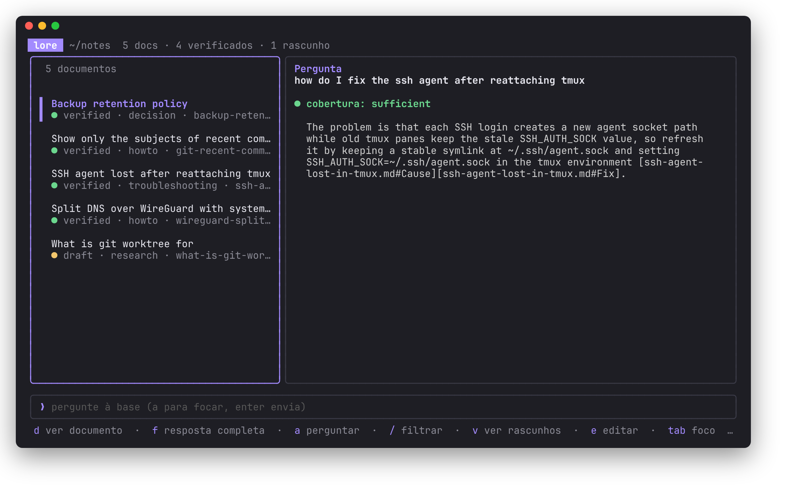
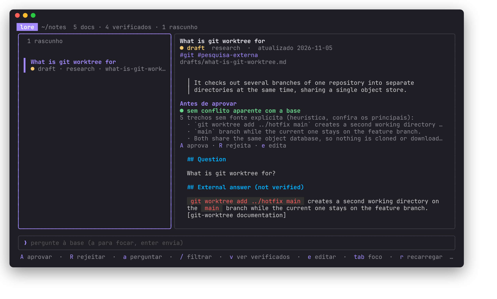

# lore

A curated personal knowledge base you query in natural language, that learns
from the questions it cannot answer yet.



Your knowledge lives as plain Markdown files in a Git repository. Ask a
question and lore answers from those files, citing the exact file and section
it used. When the base has nothing on the subject, lore can research it, give
you a provisional answer marked as unverified, and save a draft. The draft only
becomes trusted knowledge after you review it.

The goal is not to pile up chat logs. It is to turn recurring questions into
durable, readable, versioned notes.

> **Language note:** the CLI, the TUI and the prompts sent to models are in
> Portuguese for now. Your documents and questions can be in any language.

## Highlights

- **Answers with sources.** Every answer cites `file#section`. A synthesis
  that cites a file it was not given is thrown away and you get the extracted
  passages instead.
- **Short answer first.** `lore ask` prints a one to three sentence answer;
  `--full` shows the complete one. Documents carry a reviewed `summary` that
  doubles as the short answer when no model is involved.
- **Any agent you already have.** Pi, Claude Code, Codex, agy, any
  OpenAI-compatible endpoint, or your own CLI, chosen per task. Agents run with
  no tools, no session and an empty working directory.
- **Human review by default.** Research and imports land in `drafts/`. You can
  opt into automatic approval per source, and anything approved that way stays
  marked and in the review queue until you confirm it.
- **Local first.** SQLite FTS5 search, optional embeddings, no network unless
  you enable research. Secrets are detected and block anything leaving the
  machine.
- **Your data stays plain.** Markdown plus front matter, in a repository you
  own. The index is disposable and rebuilt from the files.

## Install

Requires Python 3.11+ and, for the TUI, Go.

```sh
curl -fsSL https://raw.githubusercontent.com/Ruivalim/lore/main/install.sh | bash
```

It uses pipx, or uv, or a venv of its own, builds the TUI when Go is around,
and `install.sh --uninstall` removes both. Your knowledge bases and config are
never touched. From a clone, `./install.sh` does the same; `make install` is the
editable install for working on lore itself.

## Quick start

```sh
lore init ~/notes --lang en       # new knowledge base, with git init
lore config --global --init       # then set repository.root: ~/notes
lore new --type howto --title "Rotate SSH keys"
lore edit rotate-ssh-keys         # fill in the template in $EDITOR
lore review                       # what is waiting for you
lore approve rotate-ssh-keys --human
lore ask "how do I rotate ssh keys"
lore ask                          # no question opens the TUI
```

A new base is not empty: `lore init` adds a few verified documents about lore
itself under `knowledge/lore/`, so `lore ask "how do I approve a draft"` works
on day one. Pick the language with `--lang pt|en`, skip them with `--no-seed`,
and run `lore seed` after upgrading lore to refresh them. Documents you edited
or deleted are left alone.

Try it without writing anything first, using the bundled example base:

```sh
lore --root examples/acervo reindex
lore --root examples/acervo ask "subjects of recent commits" --extractive
```

```text
Run `git log --format=%s -10` to print just the subject line of the last 10
commits. [knowledge/git-recent-commit-subjects.md#Procedure]

(resposta completa: lore ask --full)
```

## Commands

| Command | What it does |
| --- | --- |
| `lore init [path]` | Create a knowledge base (`knowledge/`, `drafts/`, `archive/`, `.lore/`) with the lore docs |
| `lore seed` | Install or refresh the documents about lore itself, keeping your edits |
| `lore ask [question]` | Answer from the base; no question opens the TUI. `--full`, `--extractive`, `--local-only`, `--yes` |
| `lore search <terms>` | Ranked passages, filter with `--type` and `--tag` |
| `lore import <file>` | Bring in any Markdown; an agent suggests title, type, tags and summary |
| `lore new`, `lore add` | Draft from a template, or add a file that already has front matter |
| `lore review [id]` | Review queue, or one draft with unsourced claims and possible conflicts |
| `lore approve`, `reject`, `archive`, `stale` | State changes, all require `--human`; `approve` also reactivates a stale document |
| `lore doctor [--probe]` | Check documents, links, config keys and agents; `--probe` calls each agent |
| `lore list`, `show`, `edit`, `reindex`, `config` | The rest |

Every command takes `--json` for scripting.

## The TUI

`lore ask` with no question opens a two pane browser: the base on the left
with a filter, the reader or the answer on the right, and a question box.



`a` asks, `f` switches between the short and the full answer, `v` cycles
between all documents, drafts and verified ones, `A` approves a draft or
reactivates a stale document, and `R` rejects a draft with a reason. Before research starts there is a short
countdown you can cancel with `esc`.

## Agents

Each task picks an agent and a model. Unset tasks use the `[llm]` default:

```toml
[llm]
agent = "pi"
model = "provider/model-id"

[llm.research]
agent = "claude"
model = "claude-opus-5-5"

[agents.my-cli]                # anything that reads a prompt and prints text
command = ["my-cli", "--quiet", "{model_args}"]
model_args = ["--model", "{model}"]
prompt = "stdin"
error_patterns = ["^Error:"]   # for CLIs that exit 0 on failure
```

Research has two modes. In `web`, lore searches and fetches the pages itself
(blocking private addresses and dropping pages that look like prompt
injection) and the agent only writes. In `agent`, Claude Code researches on its
own, with write tools and personal connectors denied and an optional spending
cap.

## Review policy

```toml
[review]
import = "human"     # human | auto-if-clean | auto
research = "human"
```

`auto-if-clean` approves research only with at least one web source, no
unsourced passages, no page dropped for injection and no conflict with the
base. For imports, which are your own text, it only checks for conflicts.

## Configuration

Every option, with its default and what it does, is in
[`src/lore/config.example.toml`](src/lore/config.example.toml). That file is
the source of the defaults and the template `lore init` writes, so it cannot
drift. Global options go in `~/.config/lore/config.yaml`, per base options in
`<base>/.lore/config.toml`, and `lore doctor` warns about any key lore does not
read.

With `[git] auto_commit = true`, every change is committed and pushed if the
branch has an upstream. lore never pulls or force pushes;
`scripts/lore-sync.sh` does the pull and reindex when you write from more than
one machine.

## Documents

```markdown
---
id: wireguard-split-dns
title: Split DNS over WireGuard with systemd-resolved
summary: Give the tunnel its own DNS server and a routing domain.
type: howto
status: verified
tags:
  - linux
  - wireguard
  - dns
created_at: 2026-09-14
updated_at: 2026-09-20
verified_at: 2026-09-20
sources:
  - url: https://www.freedesktop.org/software/systemd/man/latest/resolvectl.html
    title: resolvectl(1)
    accessed_at: 2026-09-20
---
```

`type` is one of `howto`, `troubleshooting`, `reference`, `concept`,
`decision`, `research` or `note`. `status` is `draft`, `verified`, `stale` or
`archived`: only `verified` documents answer as trusted, `stale` ones answer
with a warning, and drafts and archived documents never do.

## Development

```sh
make help    # every target
make check   # ruff, go vet, gofmt, pytest, go test, wheel and TUI build
```

CI runs the same `make check` on Python 3.11 to 3.13. Design documents, in
Portuguese: [specification](docs/spec.md), [implementation plan and
deviations](docs/plan.md), [retrieval calibration](docs/CALIBRATION.md).
See [CONTRIBUTING.md](CONTRIBUTING.md) and [SECURITY.md](SECURITY.md).

## License

[MIT](LICENSE)
